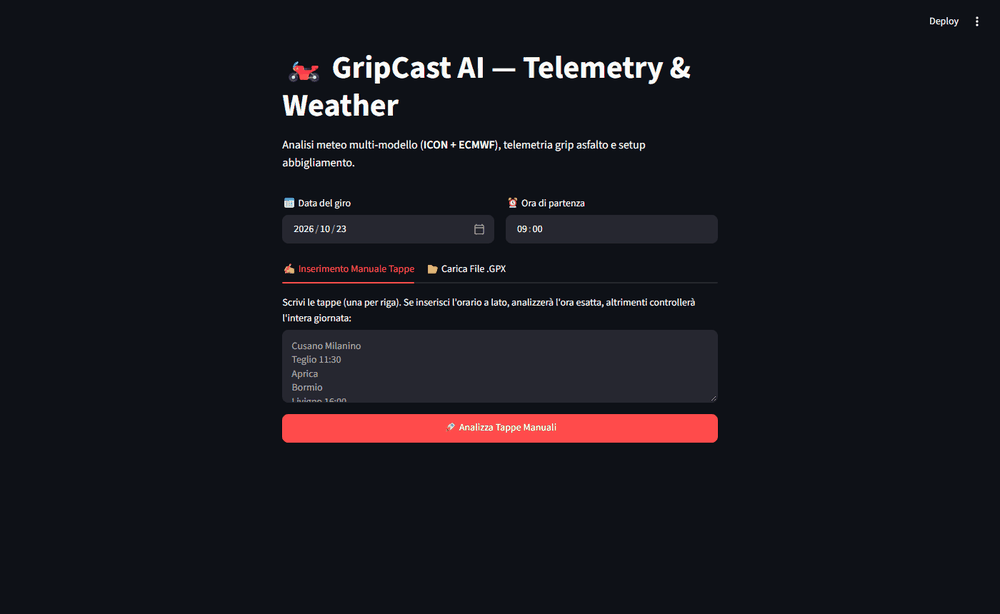
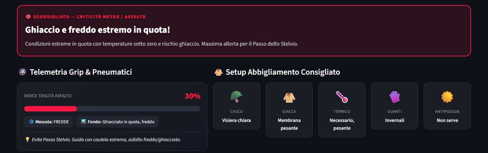
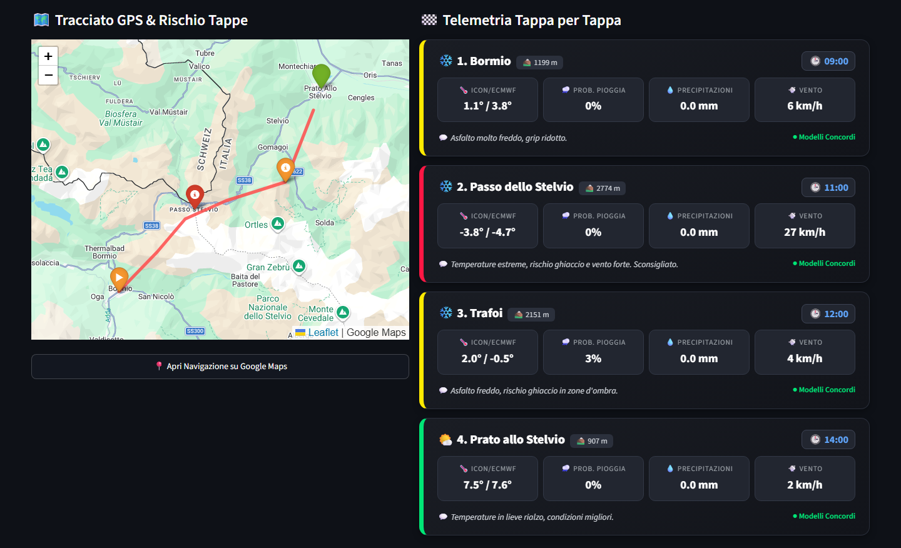
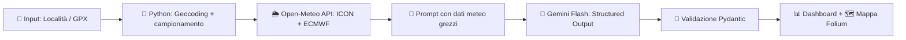

<div align="center">

# 🏍️ GripCast

### Il meteo che ragiona come un motociclista.

**Due modelli satellitari. Un'IA che li mette a confronto. Una sola domanda: oggi l'asfalto tiene?**

[](https://www.python.org/)
[](https://streamlit.io/)
[](https://ai.google.dev/)
[](https://python-visualization.github.io/folium/)
[](LICENSE)

</div>

---

## 🧭 Cos'è GripCast

Chiunque abbia guidato su un passo alpino lo sa: l'app meteo dello smartphone dice "sole" e a 2.000 metri ti ritrovi sotto la grandine. Il motivo è tecnico: la maggior parte delle app usa **un solo modello globale**, con una griglia troppo larga per "vedere" valli, creste e microclimi.

**GripCast risolve il problema incrociando due fonti:**

| Modello | Tipo | Punto di forza |
|---|---|---|
| 🌍 **ECMWF** | Globale | Il riferimento mondiale per l'affidabilità sulle tendenze a medio raggio |
| 🏔️ **ICON** (DWD) | Alta risoluzione | Griglia fitta, molto preciso sull'orografia alpina e sui fenomeni locali |

I dati di entrambi i modelli vengono scaricati tramite **Open-Meteo** e passati a **Gemini Flash**, che li analizza con **Structured Outputs JSON** e restituisce un report strutturato e sempre coerente:

- 🛞 **valutazione del grip** dell'asfalto e della temperatura del fondo;
- 🧥 **setup abbigliamento** consigliato per il giro;
- ⚠️ **allarme** quando i due modelli non sono d'accordo, cioè quando la previsione è davvero incerta.

Il risultato: non una previsione generica, ma una **telemetria pre-giro** pensata per chi viaggia su due ruote.

---

## 🎬 Anteprima Visiva

### 📂 Caricamento tracciato GPX

<p align="center">
  
</p>

### 📊 Dashboard Telemetrica

<p align="center">
  
</p>

### 🗺️ Mappa interattiva Folium

<p align="center">
  
</p>

---

## ⚡ Core Features

### 📍 Percorso manuale o tracciato GPX
Due modalità di input:
- **Manuale** → scrivi le località (partenza, tappe, arrivo) e GripCast le geocodifica in automatico tramite l'API di geocoding di Open-Meteo.
- **GPX** → carica il file esportato da Garmin, Calimoto, Kurviger & co. Il tracciato viene letto con `gpxpy` e campionato nei punti chiave per interrogare il meteo lungo tutto il percorso.

### ⏱️ Calcolo temporale intelligente
Il meteo delle 9:00 alla partenza non è quello delle 14:00 sul passo. Per questo puoi scegliere:
- **Slider durata** → imposti le ore di guida e GripCast distribuisce le tappe nel tempo, abbinando a ogni punto la previsione dell'ora in cui ci passerai davvero.
- **Intera Giornata** → analisi completa dell'arco diurno, ideale per giri senza orari fissi o per pianificare la finestra migliore.

### 🛞 Telemetria Grip
Il cuore dell'app. Gemini valuta temperatura dell'aria, precipitazioni e condizioni del fondo per stimare:
- **Indice Tenuta Asfalto** (0–100%) con barra colorata 🟢 🟡 🔴;
- **stato della mescola** (gomme fredde, in temperatura, ecc.) in base alla **temperatura stimata dell'asfalto**;
- **condizione del fondo** e un **consiglio di guida** sintetico.

### 🚨 Allarme Modelli Discordi
Quando la probabilità di pioggia tra **ICON ed ECMWF differisce di oltre il 50%** (o c'è una netta discrepanza sui millimetri previsti), GripCast imposta l'accordo tra modelli su **BASSO** e mostra un avviso ben visibile.

Sotto l'avviso trovi una **tendina esplicativa HTML** espandibile che spiega in linguaggio tecnico *dove* e *perché* i modelli non sono d'accordo. Così sai che quella previsione va presa con le pinze, e magari conviene avere l'antipioggia nel bauletto. 🌧️

### 🗺️ Mappa dinamica + navigazione
Il percorso viene disegnato su una **mappa interattiva Folium** con i marker delle tappe. Un pulsante dedicato genera il link **Google Maps Directions** già compilato con partenza e destinazione: un tap e parte il navigatore. 📲

---

## 🧰 Stack Tecnologico

| Libreria | Ruolo |
|---|---|
| 🎈 [`streamlit`](https://streamlit.io/) | Interfaccia web reattiva e gestione dello stato |
| 📍 [`gpxpy`](https://github.com/tkrajina/gpxpy) | Parsing dei tracciati GPX |
| 🗺️ [`folium`](https://python-visualization.github.io/folium/) + `streamlit-folium` | Mappe interattive Leaflet integrate in Streamlit |
| 🤖 [`google-genai`](https://github.com/googleapis/python-genai) | SDK ufficiale per Gemini Flash |
| 🧱 [`pydantic`](https://docs.pydantic.dev/) | Schema tipizzato per gli Structured Outputs JSON |

Dipendenze di supporto: `requests` (chiamate a Open-Meteo) e `python-dotenv` (caricamento del file `.env`).

---

## 🛠️ Guida all'Installazione

> **Requisiti:** Python 3.10+ e Git.

**1. Clona il repository**
```bash
git clone https://github.com/MirkoGiussani02/GripCast.git
cd GripCast
```

**2. Crea l'ambiente virtuale**
```bash
python -m venv venv
```

**3. Attiva l'ambiente virtuale**
```bash
# Windows (PowerShell)
.\venv\Scripts\Activate.ps1

# macOS / Linux
source venv/bin/activate
```

**4. Installa le dipendenze**
```bash
pip install -r requirements.txt
```

**5. Avvia l'app**
```bash
streamlit run app.py
```

L'app si apre automaticamente su `http://localhost:8501`. 🏁

---

## 🔐 Configurazione Sicurezza

GripCast ha bisogno di una chiave API di Gemini per funzionare.

**1.** Crea un file chiamato **`.env`** nella **cartella principale** del progetto (accanto ad `app.py`).

**2.** Inserisci la tua chiave:
```env
GEMINI_API_KEY=la_tua_chiave_qui
```

**3.** Riavvia l'app. Fatto.

> [!TIP]
> 🔑 La chiave si ottiene **gratuitamente** da **[Google AI Studio](https://aistudio.google.com/apikey)**: basta un account Google.

> [!WARNING]
> ⛔ **Non pubblicare mai il file `.env` su GitHub.** È già incluso nel `.gitignore`: non rimuoverlo. Se per errore esponi la chiave, revocala subito da Google AI Studio e generane una nuova.

Se il file `.env` non viene trovato, l'app ti chiede di inserire la chiave direttamente nell'interfaccia, in un campo password che non viene salvato su disco.

---

## 🏗️ Architettura

Per massimizzare la velocità ed evitare gli errori intermittenti del *function calling* combinato con lo schema JSON di Gemini, GripCast **non delega all'LLM il recupero dei dati**. Il flusso è deterministico: Python geocodifica le tappe e scarica il **meteo grezzo** (ICON + ECMWF) con chiamate dirette alla **Open-Meteo API**, normalizza i valori (i dati mancanti vengono gestiti in modo sicuro) e li **inietta direttamente nel prompt**. Gemini Flash riceve quindi un contesto già completo e deve solo ragionare e rispondere secondo uno **schema Pydantic** tramite Structured Outputs. Risultato: una sola chiamata al modello, nessun round-trip tool ↔ LLM, output sempre validabile e un **fallback automatico** tra modelli Gemini in caso di sovraccarico dei server (errori 429/503).



---

<div align="center">

**Fatto con ☕ e benzina da chi preferisce le curve alle previsioni sbagliate.**

🏍️ *Ride safe. Check the grip.* 🏍️

</div>
